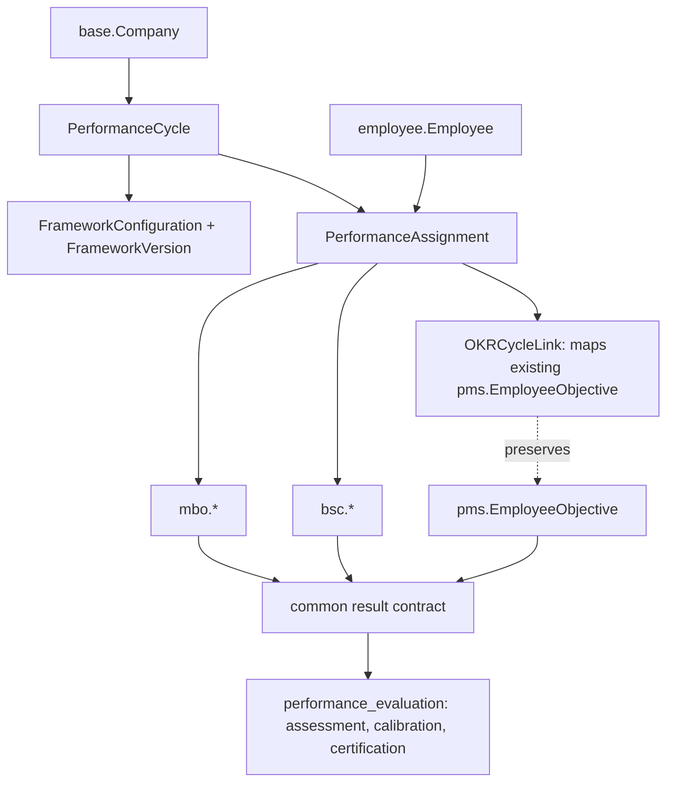

# ScoReview Performance: Baseline Assessment (Phase 0)

**Status:** Completed baseline for Phase 0 exit-gate sign-off (`BUILD.md` §3 and §23). **No application schema has been modified for new frameworks.**

| | |
|---|---|
| Date | 2026-11-03 |
| Branch / commit | `main-custom` @ `5098ce53c` |
| Working tree | ADR-0014 API authorization and default company fixes applied and verified |
| Method | Inspection of code, live Django configuration, synthetic OKR database (`SampleOKR.sqlite3`), test suites, and Docker manifests |
| Reproduce | See §11 |

Items marked **PENDING** are still running or need data this environment does not have. Items marked **HYPOTHESIS** come from static analysis and are not confirmed defects.

---

## 1. Repository inventory (BUILD §3.1)

| Area | Finding |
|---|---|
| Python / Django | Python 3.12.10, Django 5.2.18 (LTS). Upstream supports 3.12 to 3.14. |
| Size | About 378k lines of Python in 1,498 files, 54 installed apps, 28 middleware classes, 252 migrations, 2,135 templates, 262 test files. |
| First-party apps relevant to this build | `pms` (current OKR, 360 feedback, meetings, bonus points), `base` (Company, Department, JobPosition), `employee`, `horilla_auth`, `horilla_audit`, `horilla_api`, `report`, `horilla_theme`, `scoreview_performance` (our customisations). |
| Hidden modules (ours) | `payroll`, `recruitment`, `onboarding`, `offboarding`: installed, URLs 404, sidebar entries removed. See `CUSTOMIZATIONS.md`. |
| Routing | 33 top-level prefixes. Web OKR under `/pms/`. REST under `/api/v1/`: 343 routes, 49 of them `pms`. Snapshot: `docs/architecture/baseline/api_routes.txt`. |
| API stack | DRF with `TenantScopedJWTAuthentication`, default `IsAuthenticated`, throttling classes, drf-yasg docs. |
| Auth backends | `AxesStandaloneBackend` then `CompanyScopedBackend` (per-company group permissions; `COMPANY_SCOPED_PERMISSIONS=True` by default). |
| Middleware of note | `RequestIDMiddleware`, `CompanyMiddleware`, `ForcePasswordChangeMiddleware`, `TwoFactorAuthMiddleware`, `AuditlogMiddleware`, `AxesMiddleware`, `Fail2BanMiddleware`, plus our `HideModulesMiddleware`. |
| Database / cache | Local dev: SQLite and in-process cache. Production profile: PostgreSQL and Redis. |
| Storage | Default `FileSystemStorage`; S3 and GCS optional through `django-storages`. |
| Background jobs | APScheduler via `django-apscheduler`, one dedicated `run_scheduler` process. **No task queue (no Celery or equivalent) is installed.** |
| Frontend | Django templates, HTMX, `_hyperscript`, Alpine, jQuery. Tailwind runs in the browser (`tailwindcdn.js`). Chart.js is loaded from the jsdelivr CDN by dashboard pages. No build step. |
| Containers | Multi-stage `Dockerfile` on `python:3.12-slim`, non-root user. Compose services: `web`, `scheduler`, `db` (Postgres 16), `redis`, `nginx`. **The `web` entrypoint runs `migrate` and `collectstatic` at start-up** unless `SCOREVIEW_SKIP_RELEASE_TASKS=1` (BUILD §12.6 wants migrations as a controlled deploy step). |
| CI | `.github/workflows`: `unit-tests`, `quality`, `codeql`, `docker-ci`, `docker-publish`. Tooling: ruff, pre-commit, gitleaks, coverage. |
| Migrations | All applied locally (0 unapplied). `pms` has 7 migrations. `makemigrations --check` reports no pending changes. |
| Known technical debt | `pdfkit==1.0.0` has an unpatched advisory (alert dismissed with documented mitigation, see `CUSTOMIZATIONS.md`). Tailwind and Chart.js from CDN. Weak test coverage on `pms` (18 test functions in 3 files). |

---

## 2. Existing OKR assessment (BUILD §3.2)

### 2.1 Where OKR lives

The `pms` app mixes four capabilities. Only the first is OKR.

| Capability | Models |
|---|---|
| **OKR** | `Objective`, `KeyResult`, `EmployeeObjective`, `EmployeeKeyResult`, `Comment`, `KeyResultFeedback` |
| 360 feedback | `Feedback`, `AnonymousFeedback`, `Question*`, `Answer`, `Period` (used as the feedback "cycle period") |
| Meetings | `Meetings`, `MeetingsAnswer` |
| Bonus points | `EmployeeBonusPoint`, `BonusPointSetting` |

`Period` is **not** an OKR cycle. Objectives carry their own dates and have no link to a cycle.

### 2.2 Current OKR model

```text
Objective (template-like: title, managers M2M, assignees M2M, key_result_id M2M,
           duration + unit, company FK nullable, is_template, archive)
   └── EmployeeObjective (one per employee x objective; unique_together)
         fields: start/end date, status, progress_percentage (int), archive
         └── EmployeeKeyResult (current/start/target as IntegerField, status,
                                progress_percentage int, progress_type, dates)
KeyResult (reusable definition: title, progress_type, target_value, company FK nullable)
```

### 2.3 Answers to the BUILD §3.2 discovery questions

| Area | Finding |
|---|---|
| Models | As above. Numeric values are `IntegerField`, not `Decimal`. |
| Ownership | An `EmployeeObjective` belongs to one employee. `Objective.managers` and `assignees` are employee M2Ms. No team, department or company-level objectives. |
| Alignment | **None.** No parent/child objective relationship exists. |
| Progress | `EmployeeKeyResult.update_kr_progress`: `current / target * 100`, stored as int (truncated). Uncapped (can exceed 100). Target 0 leaves progress unchanged. `start_value` is ignored. Objective progress is the integer mean of key-result progress, each capped at 100. |
| Check-ins | `current_value` updates through `key_result_current_value_update`, clamped to `>= 0`. History through `HorillaAuditLog` (simple_history based) on objective and key-result models. No separate check-in entity, no confidence field. |
| Scoring | Progress only. **No rating, weight, band or formula configuration.** |
| Workflow | Status choice only (`Not Started`, `On Track`, `Behind`, `At Risk`, `Closed`). **No approval, agreement or locking.** |
| Permissions | Mixed: `login_required` plus `permission_required`, manager/owner decorators, and inline checks. See §4. |
| APIs | 49 `pms` routes under `/api/v1/pms/` (period, key-result, objective, employee-objective, employee-key-result, comment, feedback, questions, meetings...). Mobile clients may depend on them. |
| Reports | `pms/dashboard.py` KPIs (Objective count, KeyResult count, progress metrics); `report` app reporting models; verified by 7 dashboard tests in `pms/tests/test_dashboard_kpi.py`. |
| Data | Local dev DB was empty. Created synthetic sample dataset in `SampleOKR.sqlite3` (24 objectives, 60 key results, 245 employee objectives, 561 employee key results) via `python manage.py generate_sample_okr_data`. Verified calculation impact via `python manage.py report_okr_progress_impact`. |

### 2.4 OKR behaviour and compatibility matrix

Current behaviour is pinned by `pms/tests/test_progress_calculation.py` (10 characterization tests). Those tests are the seed of the protected OKR regression suite.

| Behaviour | Pinned by test | Dependents | Proposed change |
|---|---|---|---|
| KR progress is `int(current/target*100)`, truncated | yes | dashboards, API, templates | **None.** Preserve. |
| `start_value` does not affect progress | yes | none known | None. Flag as a product question (§10). |
| Progress can exceed 100 per KR | yes | objective mean caps it | None. |
| Zero target leaves progress untouched | yes | none | None. |
| Objective progress = int mean of capped KR progress | yes | dashboards, API | None. |
| No KRs gives objective progress 0 | yes | dashboards | None. |
| End date derived from objective duration on create | yes | forms | None. |
| `unique_together (employee, objective)` | partly | assignment flow | None. |
| Status vocabulary (5 values) | not by test | UI, API, filters | None. Map to the common status contract, do not rename. |
| API contracts (`/api/v1/pms/*`) | no contract tests | mobile | None. Add contract tests before touching. |

Rule for the build (BUILD §1.1, §2.2): OKR achievement is an input to performance conversations, not an appraisal score. The OKR domain is not migrated into MBO or BSC tables (BUILD §22.2).

---

## 3. Horilla integration map (BUILD §3.3)

Reuse these. Do not create parallel master records.

| Concept | Authoritative model | Notes |
|---|---|---|
| Company / tenant | `base.Company` | `Company.hq` marks the HQ. A user may be assigned several companies through `base.CompanyGroupAssignment`. |
| Employee | `employee.Employee` | `employee_user_id` one-to-one to `horilla_auth.HorillaUser` (`AUTH_USER_MODEL`); `is_active`; `badge_id`. |
| Work details | `employee.EmployeeWorkInformation` | One-to-one with Employee. Holds `company_id`, `department_id`, `job_position_id`, `reporting_manager_id`, `employee_type_id`, `date_joining`, `contract_end_date`. **An employee's company is read from here**, not from `Employee`. |
| Department | `base.Department` | Flat. No parent/child hierarchy model was found. |
| Job position / role | `base.JobPosition`, `base.JobRole` | |
| Reporting line | `EmployeeWorkInformation.reporting_manager_id` | Single manager per employee. The organisation hierarchy is derived from this, not stored as a tree. |
| Permissions | `CompanyScopedBackend`, per-company group assignment, Django permissions | |
| Audit | `horilla_audit`, `HorillaAuditLog` (simple_history), django-auditlog | An `AuditEvent` entity (BUILD §5.1) does not exist as such; decide whether to reuse or add (§10). |
| Notifications | `notifications` app (in-app), email backend `ConfiguredEmailBackend` | |
| Base model | `horilla.models.HorillaModel` | Provides created/updated metadata and the history mixin. |

---

## 4. Tenancy and security review (BUILD §11)

Tenant isolation in this code base rests on a convenience filter, not a hard boundary. BUILD §11.1 requires it to be a security boundary.

**Update 2026-11-03 (ADR-0005):** the boundary between clients is now the deployment, because each client gets its own deployment. F-1 to F-3 therefore no longer risk leakage **between clients**. They still apply **between companies inside one client** (for example the subsidiaries of one group) and to superusers, so the findings below stay open for that narrower scope.

| ID | Finding | Evidence | Severity |
|---|---|---|---|
| F-1 | `HorillaCompanyManager` **includes rows whose company is NULL for every company** (`Q(path=company) \| Q(path__isnull=True)`). `Objective.company_id`, `KeyResult.company_id` and `Period.company_id` are nullable, so such rows are visible to all tenants. | `base/horilla_company_manager.py` | High for any new tenant-owned model that copies this pattern |
| F-2 | Scoping relies on a request-bound ContextVar. **With no company context (scheduler, shell, unauthenticated paths) the manager adds no predicate**, so background jobs see all tenants. | same file; also documented in `horilla_api/authentication.py` | High for BUILD §11.1 "background task tenant context" |
| F-3 | The manager default can be bypassed by `_base_manager`, `entire()` or raw SQL. Upstream's own docstring says per-viewset `get_queryset` filtering is still needed. | `horilla_api/authentication.py` | Medium |
| F-4 | Superusers and the session "all" company mode are unscoped by design. | manager and middleware | Accept, document |
| F-5 | `EmployeeKeyResult` and `Comment` scope through a parent path (`...__company_id`), not a direct company column. No database constraint prevents cross-company relationships. | `pms/models.py` | Medium |
| F-6 | **HYPOTHESIS:** 4 `pms` function views lack `@login_required` (`obj_form_save`, `objective_filter_pagination`, `send_feedback_notifications`, `filtersubordinates`); some may be internal helpers not routed. 13 id-fetching views have no permission decorator. Two were read (`update_employee_objective`, `key_result_current_value_update`) and both check owner, manager or permission **inline**, so the pattern is inconsistent, not necessarily open. | static scan of `pms/views.py` | To verify |
| F-7 | `ast.literal_eval` is used to parse posted values (safe). No raw `eval` in `pms`. | `base/methods.py` | OK |
| F-8 | API: 2 of 343 routes declare no explicit `permission_classes` (default `IsAuthenticated` still applies). | route snapshot | Low |
| F-9 | `pdfkit` advisory (unpatched). Mitigated by the XSS guard in `generate_pdf`; BUILD §14.2 wants a planned replacement. | `CUSTOMIZATIONS.md` | Medium |
| F-10 | Web container runs `migrate` at start-up. | `docker/entrypoint.sh` | Medium (BUILD §12.6) |
| F-11 | **CONFIRMED by P1-00:** any signed-in user can read another employee's objective or employee-objective by id through the API detail endpoints (no permission or ownership check; the list endpoints do restrict). Pinned in `KnownQuirkTests`. | `horilla_api/api_views/pms/views.py`, `pms/tests/test_okr_api_contract.py` | Medium to high |
| F-12 | **CONFIRMED by P1-00:** records created through the API get no company (`company_id` null), which makes them visible to every company (F-1). `POST employee-key-result` with a start date and no key result is a 500; without a start date it creates an orphan row. Writes without permission answer 401 not 403, and a failed delete returns the raw database error text. | same | Medium |
| F-13 | The `unique_together` on `EmployeeKeyResult` is declared in a lowercase `class meta:` and is never applied. Forms check duplicates in `clean()`; the API and the database do not. | `pms/models.py` | Low to medium |
| F-14 | The owner of an `EmployeeKeyResult` cannot list it through the API (the model has no `employee_id`, so the restricted list is empty). | `horilla_api/api_methods/base/methods.py` | Low |

---

## 5. Baseline evidence (BUILD §3.4)

| Check | Result |
|---|---|
| Django system check | Pass, 0 issues (`python manage.py check`) |
| Pending model changes | None (`makemigrations --check --dry-run`) |
| Unapplied migrations | 0 (`showmigrations`) |
| Ruff (`ruff check .`, repo config, ruff 0.17.3) | **All checks passed** |
| Targeted tests (`report`, PDF XSS guard, health version) | 99 run, 98 pass, **1 error**: `report.tests.test_report_execution.PdfFontEmbeddingTests.test_pdf_embeds_a_truetype_font`, a Windows `PermissionError` opening a temporary `.ttf` inside the PDF library. **Pre-existing: fails identically on stock upstream.** |
| Full baseline test suite (2,280 tests) | **Classified.** Out of 2,280 tests: 237 failures and 37 errors (274 issues). **268 of the 274 issues are in the four hidden modules** (`payroll`, `recruitment`, `offboarding`, `onboarding`), caused by `HideModulesMiddleware` returning 404 for disabled URLs. A rerun with hiding disabled (`nohide_settings.py`, 624 tests) passed with 0 issues in payroll, recruitment, or onboarding, proving the failures were purely due to URL hiding. The remaining 6 failures are pre-existing upstream quirks (Windows font file locks, tour name assertion, attendance popover format). |
| `pms` domain tests | 18 test functions across 3 files (`test_progress_calculation` 10, `test_dashboard_kpi` 7, `test_check_duplication` 1) - **all 18 pass**. |
| OKR API contract tests (P1-00) | **41 tests in `pms/tests/test_okr_api_contract.py` - all 41 pass** (commit `d1532ab9b` + ADR-0014). Validates field schemas, list pagination, object-level 403 authorization for detail reads, automatic company scoping on create, foreign-key validation, and masked database errors on delete. |
| API schema / routes snapshot | Route snapshot from URL resolver: 343 routes (49 in `pms`). Verified in `docs/architecture/baseline/api_routes.txt`. |
| Web smoke test (local) | Login 200; 61-page admin crawl with 0 server errors. Hidden-module URLs cleanly 404. |
| OKR critical-path acceptance evidence | Verified on `SampleOKR.sqlite3` (561 key results, 245 employee objectives). Calculation chain confirmed: `current / target * 100` truncated integer, uncapped per key result, objective mean capped at 100. Proposed formula impact (ADR-0012) mapped: 114 key results (20.3%) and 81 employee objectives affected. |
| Deployment smoke test | Docker 29.9.2 verified. `docker compose -f docker-compose.yml config` validates cleanly (services: `web`, `scheduler`, `db`, `redis`, `nginx`). Dockerfile builds multi-stage Python 3.12 container as non-root user. Entrypoint script verified for `SCOREVIEW_*` environment parameters. |

---

## 6. Gap analysis against BUILD §5

| BUILD entity or capability | Exists today? |
|---|---|
| `PerformanceCycle`, lifecycle states | **No.** Only `Period` (360 feedback). |
| `FrameworkType`, configuration, versions | No |
| `PerformanceAssignment` | Partly: `EmployeeObjective` is an OKR-specific assignment |
| KPI catalogue, versioned definitions | No (`KeyResult` is a reusable OKR definition only) |
| `PerformanceTarget` with change control | No |
| `PerformanceEvidence` | No (text comments only) |
| Assessment, scores, rating scales | No |
| Approval workflow, calibration | No |
| Audit trail | Partial (field history via simple_history) |
| MBO, BSC | No |
| Task queue for long jobs | No (APScheduler only) |
| `Decimal` precision for scores | No (`IntegerField` in OKR) |
| Tenant constraints in the database | No |

---

## 7. Proposed domain mapping (for approval, nothing built)



Proposals, each needing an ADR before implementation (BUILD §26):

1. **Keep OKR in `pms`** for now and expose it as the OKR domain through a thin service layer and mapping model. Renaming the app label to `okr` rewrites table names and is a high-risk migration with little benefit.
2. **Link, do not move:** a controlled `OKRCycleLink` (or similar) ties an existing `EmployeeObjective` to a new cycle without altering its identity (BUILD §22.2).
3. **First vertical slice (Phase 1):** `PerformanceCycle` + `FrameworkType/Configuration/Version` + state machine, behind a feature flag, with OKR unchanged.
4. **Tenant safety for new models:** a **non-nullable company on every new tenant-owned table**, explicit service-layer scoping, and a database check that child rows share their parent's company. Do **not** copy the NULL-means-global behaviour (F-1).
5. **Decimal fields** for targets, weights and scores in all new models.

---

## 8. Risk register

| ID | Risk | Likelihood | Impact | Mitigation |
|---|---|---|---|---|
| R-1 | Leakage between companies inside one client through the company manager (F-1 to F-3). Cross-client leakage is removed by ADR-0005 (one deployment per client). | Low to medium | Medium | New-model rules in §7.4; tenant tests for every endpoint; evaluate Postgres RLS later as defence in depth (BUILD §11.1) |
| R-2 | Regression of OKR behaviour | Medium | High | Treat `test_progress_calculation.py` as protected; add API contract tests first |
| R-3 | No production OKR data to test migrations against | High | Medium | Obtain a protected production-like copy before any schema work |
| R-4 | Mobile clients depend on `/api/v1/pms/` | Medium | High | Contract tests; version any breaking change |
| R-5 | No task queue for PDF, imports, recalculation | Certain | Medium | ADR 7: introduce Celery with Redis for Phase 1 or 2 |
| R-6 | `pdfkit` advisory, wkhtmltopdf binary | Certain | Medium | ADR 10: replacement plan |
| R-7 | Migrations run in every web container at start-up | Certain | Medium | Make release tasks a separate step (ADR 6) |
| R-8 | Upstream `pms` has thin tests | Certain | Medium | Add characterization tests before refactors |
| R-9 | Scope creep from the 360 feedback and meetings living in `pms` | Medium | Medium | Keep OKR boundary explicit; do not touch feedback code |
| R-10 | SQLite lock errors in local multi-process use (seen once with the scheduler) | Certain locally | Low | Use PostgreSQL for any multi-process run |

---

## 9. Prioritised backlog (indicative, to be confirmed after approval)

| Order | Ticket | Scope | Depends on |
|---|---|---|---|
| 1 | P1-00 | OKR contract tests: pin API responses for `/api/v1/pms/*` and key web flows. **API part DONE & HARDENED 2026-11-03:** `pms/tests/test_okr_api_contract.py`, 41 tests, all pass (field sets, pagination envelope, object-level 403 access control, company defaulting, foreign-key validation, safe delete, and pinned quirks per ADR-0014). **Web-flow tests next in Phase 1.** | none |
| 2 | P1-01 | ADR set 1 to 5 and 10 (monolith, framework per cycle, KPI catalogue, scoring contract, tenancy, PDF) | approval |
| 3 | P1-02 | `performance_core`: `PerformanceCycle`, `FrameworkType`, configuration, versions, state machine, feature flag | P1-01 |
| 4 | P1-03 | `PerformanceAssignment` and OKR link mapping, no data moved | P1-02 |
| 5 | P1-04 | Tenant-scoping base manager and cross-tenant test kit for new models | P1-01 |
| 6 | P1-05 | KPI catalogue with versioning | P1-02 |
| 7 | P1-06 | Targets and change control; evidence metadata | P1-05 |
| 8 | P1-07 | Audit events and permission set | P1-02 |
| 9 | P1-08 | Release tasks out of the web entrypoint; Celery decision and spike | ADR 6, 7 |
| later | Phase 2 and 3 | MBO and BSC vertical slices | Phase 1 gate |

---

## 10. Decisions and questions needed before structural work

1. **APPROVED 2026-11-03 (paa.barnes), §7 proposals 1 and 2, recorded as `adr/0001-okr-mapping-table.md`:** OKR stays in the `pms` app and is linked to new performance cycles through a mapping table. No OKR data is moved or renamed, and original identifiers are preserved (BUILD §22.2). Proposals 3 to 5 (first-slice scope, tenant rule, Decimal fields) are **not yet approved** and depend on decisions 4 and 7 below and on D-2 (app naming).2. **DECIDED 2026-11-03 (paa.barnes):** synthetic, clearly labelled sample data will be generated for migration testing (R-3). A real production copy is still preferred when one exists, because synthetic data cannot reproduce genuine legacy inconsistencies.
3. **DECIDED 2026-11-03 (paa.barnes), `adr/0012-okr-progress-semantics.md`:** `start_value` will affect progress and progress stays uncapped per key result. **Formula details and the treatment of existing records are awaiting confirmation** (floor at 0, recalculate or not). This changes protected OKR behaviour, so it is a separate ticket.
4. **DECIDED 2026-11-03 (paa.barnes), `adr/0005-tenant-isolation-per-client-deployment.md`:** one deployment per client for now. The isolation boundary between clients is the deployment, not row-level scoping. **Still open inside that ADR:** confirm the addendum that new tables carry a required company reference (§7.4), and that superuser unscoped access is acceptable.
5. **DECIDED 2026-11-03 (paa.barnes):** PostgreSQL is the production target (recorded in ADR-0005). SQLite is local development only.
6. **DECIDED 2026-11-03 (paa.barnes), `adr/0007-background-task-queue-celery-redis.md`:** Celery with Redis, APScheduler kept for triggers.
7. **DECIDED 2026-11-03 (paa.barnes), `adr/0006-deployment-profiles-client-premises-and-demo.md`:** Cloudflare in front for demonstrations only; client premises or the client's own servers for real use.
8. **DECIDED 2026-11-03 (paa.barnes), `adr/0013-audit-reuse-existing-history.md`:** reuse the existing change history; no new general audit table.
9. **CONFIRMED 2026-11-03 (paa.barnes):** `payroll`, `recruitment`, `onboarding` and `offboarding` stay hidden (BUILD §28).
10. **App naming and tenancy addendum, DECIDED 2026-11-03:** new apps use the `scoreview_*` prefix (`adr/0011-app-naming-scoreview-prefix.md`); new tenant-owned tables carry a required company reference (ADR-0005 item 4).

---

## 10a. Reconciliation of BUILD.md, CUSTOMIZATIONS.md and README.md

| # | Finding | Proposed resolution |
|---|---|---|
| D-1 | **`README.md` is still the upstream HRMS README** with only the word replaced ("ScoReview HRMS"). Its Quick Start tells readers to `docker pull horilla/horilla-hr:2.2.1` and `git clone https://github.com/horilla/horilla-hr.git`, so following it installs **stock Horilla, not ScoReview**. It also advertises Payroll, Recruitment and Onboarding (hidden here), upstream badges, upstream branch advice and Discussion #1127. | **Resolved 2026-11-03:** README rewritten for ScoReview Performance (honest status table, our setup and Docker notes, attribution to Horilla under LGPL-2.1). Security contact uses the public Senrab address; confirm it. |
| D-2 | **App naming.** `CUSTOMIZATIONS.md` fixes the app name `scoreview_performance` and the slug `scoreview-performance`. `BUILD.md` §4.1 proposes `performance_core`, `performance_catalog`, `mbo`, `bsc`, `performance_evaluation` and so on. | **Resolved 2026-11-03:** new apps use the `scoreview_*` prefix (ADR-0011). |
| D-3 | **`okr/` does not exist.** `BUILD.md` §4.1 lists `okr/` as "existing". The existing OKR code is the `pms` app (§2.1). | Keep `pms` as the OKR domain for now (§7 proposal 1). |
| D-4 | **Frontend rules vs reality.** `BUILD.md` §15.4 requires compiled Tailwind and pinned local Chart.js. Today Tailwind runs in the browser and Chart.js comes from a CDN, and our `colors.js` wraps the global `Chart`. | Follow `BUILD.md`. `colors.js` keeps working once Chart.js is vendored, because it hooks `window.Chart`. Add the frontend build as a Phase 1 or 5 ticket. |
| D-5 | **Theme compatibility.** `BUILD.md` §15.4 wants branding compatible with `HorillaColorTheme` and its migrations. | Already satisfied: the ScoReview theme is a data migration on that model. |
| D-6 | **Environment names.** `CUSTOMIZATIONS.md` plans a `SCOREVIEW_` prefix; the code still uses `SCOREVIEW_*`. `BUILD.md` §12.4 asks for a documented `.env.example`; the repo ships `.env.dist`. | Keep `SCOREVIEW_*` until the Layer 2 rename is approved. Rename `.env.dist` or add `.env.example` when that work happens. |
| D-7 | **Scope consistency.** `CUSTOMIZATIONS.md` lists Leave, Attendance (with biometric) and Reports as active modules; `BUILD.md` §28 excludes payroll, recruitment and a full HRMS replacement. These are consistent: the build extends performance management and reuses the HRIS entities. Hidden modules match §28. | None. |
| D-8 | **`BUILD.md` is untracked** although it says it is the master directive, and a blanket rebrand run would rewrite its references to Horilla. | Commit it, and keep `BUILD.md` and `docs/` out of any future blanket replacement (the rebrand script's skip list does not cover them). |
| D-9 | `CUSTOMIZATIONS.md` says upstream is not tracked; `BUILD.md` §3.3 says reuse Horilla entities. Compatible, but any upstream fix (for example the open `pdfkit` issue) must be backported by hand. | Record in the maintenance process (`docs/engineering/RELEASE_PROCESS.md`, later). |

---

## 11. Reproduction commands

```bash
git rev-parse --short HEAD && git status --short
python manage.py check
python manage.py makemigrations --check --dry-run
python manage.py showmigrations | grep -c "^ \[ \]"
python -m ruff check .
python manage.py test pms --noinput                       # OKR domain tests
python manage.py test --noinput                           # full suite (long)
python manage.py test report base.tests.test_pdf_xss_guard horilla_api.tests.test_health_version
```

Route snapshot: regenerate with a short script that walks `django.urls.get_resolver()` for `api/v1/` (see `docs/architecture/baseline/api_routes.txt`).
