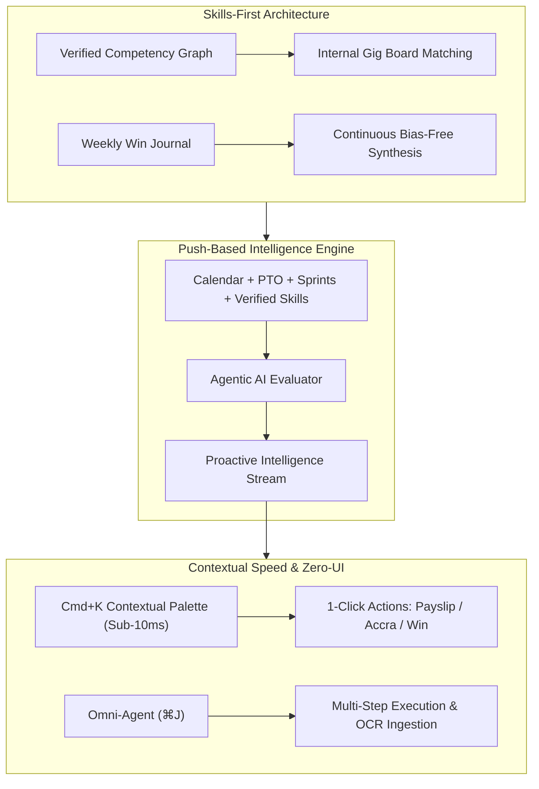

# ADR 0018: Push-Based Agentic Workforce Architecture

## Status
Accepted

## Context
Traditional enterprise HCM/HRMS platforms (such as Workday, SAP SuccessFactors, or BambooHR) are fundamentally **pull-based** and administrative-friction-heavy:
1. Employees must remember to check leave balances, locate nested forms across multi-level menus, monitor approval chains, search for payslips, and endure anxiety-inducing annual performance reviews.
2. Managers must context-switch into complex review dashboards and manually reconcile disconnected spreadsheets.
3. Organizations manage talent via static, rigid "job descriptions" that quickly become obsolete and fail to match real-time project requirements.

Senrab ConsulTech mandates a paradigm shift: **ScoReviewHR must be push-based**, actively working for the employee and eliminating administrative friction by combining:
* **Agentic AI:** Autonomous multi-step execution and proactive context calculation.
* **Contextual UX (`Cmd+K` / Zero-UI):** Sub-10ms keyboard-driven command execution.
* **Skills-First Architecture:** Dynamic competency graphs and continuous performance journaling.

## Strategic Pillars

### 1. Agentic AI (Proactive Worker vs. Passive Chatbot)
* **Background Context Synthesis:** The system monitors calendar events, upcoming bank holidays, unused PTO balances, and sprint delivery milestones.
* **Autonomous Drafting with Human Confirmation:**
  * *PTO Nudge:* The agent observes upcoming long weekends (e.g. Bank Holidays), cross-references team delivery schedules for zero conflicts, and pre-drafts leave requests requiring only a 1-click confirmation.
  * *OCR Ingestion:* Employees drag and drop receipts or medical certificates; the agent automatically extracts diagnostic codes, vendor names, dates, and amounts, filing the claim and notifying relevant parties.
  * *Document Encryption:* All sensitive payloads are automatically encrypted client-side using AES-GCM-256 before persistence.

### 2. Contextual UX (`Cmd+K` & Zero-UI)
* **Zero Menu Traversal:** Instead of navigating through four distinct submenus to find a payslip or policy document, the user triggers `Cmd+K`, types `"Payslip"` (or `"Pay"`, `"Salary"`), and hits `Enter`. The certified breakdown renders immediately.
* **Sub-10ms Speed:** The Command Palette maintains a localized index of actions, workforce members, and modules, supporting instant arrow-key execution.
* **Ambient Shortcuts:** Universal accelerators (`⌘K` for Command Palette, `⌘J` for Omni-Agent, `⌘[` for Collapsible Navigation) provide frictionless productivity for power users and mobile professionals alike.

### 3. Skills-First Architecture (Competency Graphs vs. Static Job Titles)
* **Dynamic Skill Graphs:** Employees are characterized by verified competencies (e.g. *Cloudflare Workers 95%*, *Rust 90%*, *ISO 27001 88%*) rather than static job titles.
* **Internal Gig Matching:** Project leads post high-impact stretch assignments (e.g. *Cross-Border Wasm Settlement Engine*); the platform pushes candidates matched on verified capability with estimated project bonuses.
* **Continuous Performance Journaling:**
  * Ditching the dreaded annual performance review: Employees log weekly micro-wins directly as milestones are met.
  * The agent continuously compiles these wins into an objective, bias-free appraisal draft aligned with the cycle's locked framework (OKR, MBO, or BSC).

## Consequences
* **Administrative Friction Reduction:** Reduces routine HR task time from 15–20 minutes per request down to 5–10 seconds.
* **Elimination of Recency Bias:** Appraisals are built on empirical, continuous journal records rather than manager memory from the preceding 3 weeks.
* **Internal Talent Mobility:** Staff are matched to high-impact projects based on demonstrated ability, accelerating career growth and retention.
* **Non-Negotiable Compliance:** All proactive actions, whether initiated by human or AI, are cryptographically logged to the immutable audit ledger.

